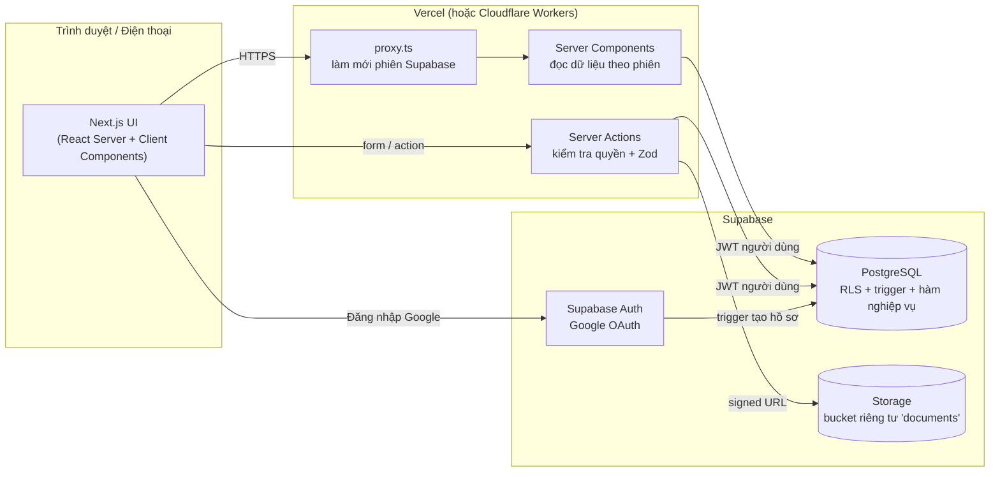
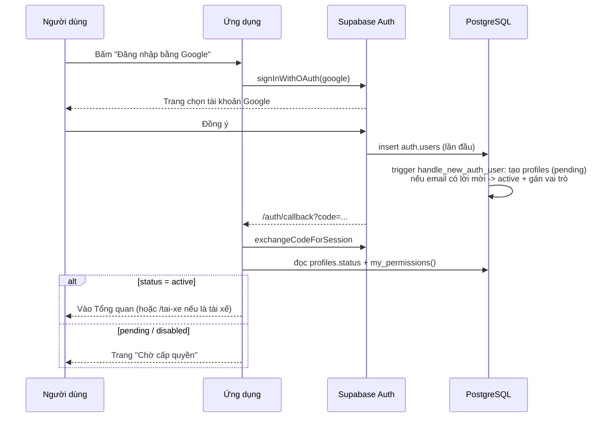

# 2. Kiến trúc hệ thống

## 2.1 Sơ đồ tổng thể



## 2.2 Nguyên tắc

1. **Ba lớp kiểm tra quyền**: (a) giao diện ẩn nút theo quyền, (b) server action gọi `requirePermission()` trước khi ghi, (c) **RLS trong PostgreSQL** là lớp cuối, không thể vượt qua từ trình duyệt.
2. **Mọi truy vấn chạy bằng JWT của người dùng** (anon key + cookie phiên). `SUPABASE_SERVICE_ROLE_KEY` **không dùng** trong ứng dụng; chỉ dành cho script quản trị chạy ngoài.
3. **Nghiệp vụ tài chính trong CSDL**: thao tác cần tính nhất quán (sinh mã, chống thanh toán trùng, khóa sửa sau duyệt, chuyển trạng thái) được bảo vệ bằng ràng buộc, unique index và trigger; các thao tác nhiều bước (duyệt, thanh toán, quyết toán) là hàm SQL `security definer` chạy trong một transaction (Giai đoạn 6–7).
4. **Dữ liệu nhạy cảm tách bảng**: `driver_sensitive` (CCCD), `vehicle_financials` + `loan_schedules` (giá mua, khoản vay), tài khoản ngân hàng tài xế. RLS chặn theo quyền `*.view_sensitive`.
5. **Trường động**: định nghĩa trong `field_definitions`, giá trị lưu ở cột `custom_fields jsonb` của bảng nghiệp vụ. Công thức dùng bộ phân tích riêng (không `eval`).
6. **Không phụ thuộc chặt nhà cung cấp**: truy cập dữ liệu qua `src/lib/supabase/*` và `src/lib/auth/*`; CSDL là PostgreSQL chuẩn (migration SQL thuần), có thể chuyển sang Postgres khác (Neon, RDS) và Storage S3-compatible.

## 2.3 Cấu trúc mã nguồn

```
gha-tms/
├─ docs/                    Tài liệu (bộ này)
├─ supabase/
│  ├─ migrations/           Migration SQL theo thứ tự (lược đồ, RLS, dữ liệu tham chiếu)
│  ├─ seed.dev.sql          Dữ liệu mẫu CHỈ cho môi trường phát triển
│  └─ tests/                Kiểm thử bảo mật CSDL (chạy trên Postgres tạm)
├─ scripts/test-db.sh       Chạy migration + kiểm thử CSDL
├─ src/
│  ├─ proxy.ts              Làm mới phiên, chuyển hướng người chưa đăng nhập
│  ├─ app/
│  │  ├─ (auth)/dang-nhap   Trang đăng nhập Google
│  │  ├─ auth/callback      Đổi mã OAuth lấy phiên
│  │  ├─ cho-cap-quyen      Trang chờ cấp quyền
│  │  ├─ (app)/...          Khu quản trị (sidebar + header)
│  │  └─ tai-xe/...         Ứng dụng tài xế (mobile-first)
│  ├─ components/           UI dùng chung (shadcn/ui), layout, bảng dữ liệu
│  ├─ lib/
│  │  ├─ supabase/          client trình duyệt, server, proxy
│  │  ├─ auth/              getCurrentUser, requirePermission
│  │  ├─ permissions.ts     Danh sách quyền, menu theo quyền
│  │  ├─ format.ts          Định dạng ngày/tiền VN
│  │  └─ formula/           Bộ phân tích công thức (Giai đoạn 3)
│  └─ types/database.ts     Kiểu dữ liệu sinh từ Supabase
└─ tests/                   Kiểm thử đơn vị (Vitest)
```

## 2.4 Luồng đăng nhập



## 2.5 Lựa chọn thay thế đã cân nhắc

| Phương án | Lý do không chọn làm mặc định |
|---|---|
| ORM (Prisma/Drizzle) kết nối trực tiếp Postgres | Phải dùng chuỗi kết nối quyền cao ở máy chủ, mất lớp RLS theo người dùng |
| Lưu toàn bộ dữ liệu động trong một bảng EAV | Khó ràng buộc, chậm; đặc tả yêu cầu bảng quan hệ cho dữ liệu cốt lõi |
| Firebase | Không có SQL/transaction mạnh cho tài chính |
