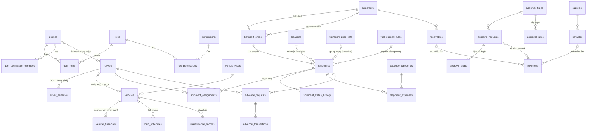

# 3. Thiết kế cơ sở dữ liệu

Nguồn sự thật: `supabase/migrations/*.sql`. Tài liệu này mô tả cấu trúc và lý do.

## 3.1 Sơ đồ quan hệ (lõi)

## 3.2 Danh sách bảng theo nhóm

| Nhóm | Bảng | Ghi chú |
|---|---|---|
| Người dùng & quyền | `profiles`, `roles`, `permissions`, `role_permissions`, `user_roles`, `user_permission_overrides`, `user_invitations` | Quyền dạng `module.action`; 92 quyền, 8 vai trò mặc định |
| Danh mục chung | `catalogs`, `catalog_items`, `company_entities`, `banks`, `payment_methods`, `bank_accounts`, `vehicle_types`, `salary_rules` | Danh mục cấu hình được, không cần sửa mã |
| Phương tiện | `vehicles`, `vehicle_financials`, `loan_schedules`, `maintenance_records`, view `vehicle_loan_summary` | Khấu hao tháng là cột sinh tự động; dư nợ chỉ từ lịch trả nợ |
| Tài xế | `drivers`, `driver_sensitive`, view `driver_vehicle_view` | Biển số được phân công suy ra từ `vehicles.assigned_driver_id` (một nguồn duy nhất) |
| Khách hàng & địa điểm | `customers`, `suppliers`, `locations`, `routes` | Địa điểm dùng chung nơi nhận/nơi giao |
| Giá | `transport_price_lists`, `fuel_support_rules`, hàm `find_price_lists()` | Ràng buộc exclusion chống chồng lấn hiệu lực |
| Điều phối | `transport_orders`, `shipments`, `shipment_assignments`, `shipment_status_history`, `code_sequences` | Mã sinh bằng `private.next_code()` an toàn đồng thời |
| Chi phí & phê duyệt | `expense_categories`, `shipment_expenses`, `advance_requests`, `advance_transactions`, `approval_types`, `approval_rules`, `approval_requests`, `approval_steps` | |
| Tiền & công nợ | `payments`, `receivables`, `payables` | `payments` là nguồn duy nhất cho dòng tiền thực tế |
| Chứng từ | `documents` | Metadata; tệp ở Storage bucket riêng tư |
| Cấu hình động | `field_definitions`, `field_definition_versions`, `form_definitions`, `form_versions`, `workflow_definitions`, `workflow_versions`, `table_view_preferences` | |
| Hệ thống | `notifications`, `audit_logs`, `system_settings` | Nhật ký chỉ ghi thêm |

Ánh xạ tên bảng trong đặc tả → thiết kế: `approvals` → `approval_requests`; `invoices_or_documents` → `documents` (hóa đơn đầu vào là một loại chứng từ `doc_type = invoice`).

## 3.3 Quy ước

- Khóa chính `uuid` (`gen_random_uuid()`), trừ bảng nhật ký dùng `bigint identity`.
- Mã nghiệp vụ (`code`, `shipment_code`...) `unique`, không đổi sau khi tạo (trigger).
- Tiền `numeric(18,2)`; tỷ lệ `numeric(6,3)` theo phần trăm.
- Mọi bảng nghiệp vụ có `created_at`, `updated_at`, `created_by`, `updated_by` (trigger tự điền).
- Xóa mềm: `status` (`inactive`, `cancelled`, `voided`) hoặc `archived_at`.
- Trường động: `custom_fields jsonb` (đã có trên `vehicles`, `drivers`, `customers`, `suppliers`, `locations`, `transport_orders`, `shipments`).

## 3.4 Chống trùng lặp và nhất quán

| Rủi ro | Cơ chế |
|---|---|
| Trùng mã Shipment khi nhiều người tạo cùng lúc | `code_sequences` + `insert ... on conflict do update ... returning` (một câu lệnh, khóa dòng); đã kiểm thử 6 phiên song song × 50 mã |
| Hai tài xế nhận cùng chuyến | Unique index một phân công `pending/accepted` mỗi chuyến |
| Thanh toán hai lần | Unique index `payments(approval_request_id)` và `payments(advance_request_id)` khi `status = posted` |
| Gửi trùng từ điện thoại | `client_request_id uuid unique` trên chi phí và ứng tiền |
| Hai người sửa cùng chuyến | Cột `version` tăng mỗi lần sửa; server action cập nhật với điều kiện `version = :v` (khóa lạc quan) |
| Biển số nhập khác định dạng | Unique index trên biển số đã chuẩn hóa (bỏ ký tự đặc biệt, viết hoa) |
| Bảng giá chồng lấn | Exclusion constraint (btree_gist) theo phạm vi + ưu tiên + khoảng ngày |
| Sửa số tiền sau khi duyệt | Trigger chặn trên `approval_requests`, `shipment_expenses`, `advance_requests` |
| Thu công nợ vượt số phải thu | `check (paid_amount <= amount)` + cập nhật trong hàm có khóa dòng (Giai đoạn 7) |

## 3.5 Chỉ mục chính

`shipments(pickup_at)`, `shipments(driver_id, pickup_at)`, `shipments(vehicle_id, pickup_at)`, `shipments(status)`, `audit_logs(entity_type, entity_id, occurred_at)`, `notifications(recipient_id) where read_at is null`, `locations` full-text (`to_tsvector('simple', ...)`), `transport_price_lists` theo phạm vi tra cứu.

## 3.6 Ước tính dung lượng

Giả định 1.500 chuyến/tháng: mỗi chuyến ~ 1 dòng shipments + 6 chi phí + 1 ứng + ~15 dòng nhật ký ≈ 25 KB kèm chỉ mục → ~40 MB/năm. Gói Supabase Free (500 MB) đủ cho vài năm dữ liệu bảng; **tệp chứng từ** (ảnh) là phần tốn dung lượng chính (xem tài liệu 10).
