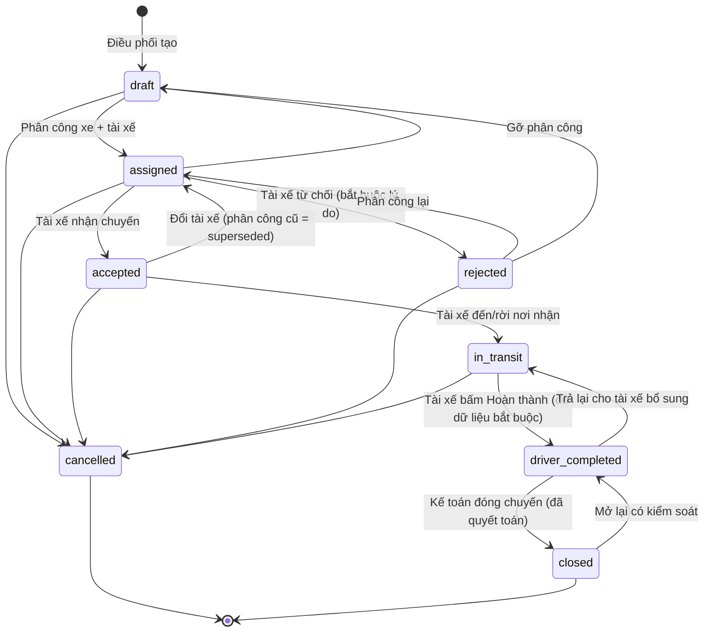

# 6. Quy trình trạng thái Shipment

Shipment có **ba trục trạng thái độc lập**, để "tài xế hoàn thành" không bị hiểu là "đã quyết toán".

## 6.1 Trạng thái vận hành (`status`)

| Mã | Tên hiển thị | Ai chuyển | Điều kiện |
|---|---|---|---|
| `draft` | Nháp | Điều phối | – |
| `assigned` | Đã phân công – chờ tài xế nhận | Điều phối | Có tài xế; tạo `shipment_assignments` (pending); thông báo tài xế |
| `accepted` | Tài xế đã nhận | Tài xế | Phân công `pending` của chính tài xế |
| `rejected` | Tài xế từ chối | Tài xế | Có lý do; thông báo điều phối |
| `in_transit` | Đang thực hiện | Tài xế | Có `arrived_pickup_at` |
| `driver_completed` | Tài xế đã hoàn thành | Tài xế | Có thời gian hoàn thành, kết quả giao, chứng từ bắt buộc theo cấu hình |
| `closed` | Đã đóng | Kế toán | `settlement_status = settled` |
| `cancelled` | Đã hủy | Điều phối/Quản lý | Bắt buộc `cancel_reason`; không xóa |

Ma trận chuyển hợp lệ được kiểm tra trong CSDL (`private.shipment_transition_allowed`), mọi chuyển đổi ghi vào `shipment_status_history`.

## 6.2 Trạng thái chứng từ (`document_status`)

`missing` (thiếu) → `submitted` (tài xế đã nộp) → `verified` (kế toán xác nhận) hoặc `rejected` (yêu cầu nộp lại → `submitted`).

## 6.3 Trạng thái quyết toán (`settlement_status`)

`unsettled` → `pending_approval` (đã lập đối soát, chờ duyệt "Duyệt quyết toán chuyến") → `settled` → (mở lại có lý do) `reopened` → `pending_approval`.

Điều kiện mặc định để `settled` (cấu hình được): chuyến ở `driver_completed`; chứng từ `verified`; không còn chi phí/ứng tiền ở trạng thái `pending`/`info_requested`; yêu cầu quyết toán đã được duyệt.

## 6.4 Khóa dữ liệu theo trạng thái

- Từ `closed` hoặc `cancelled`: không sửa đơn giá, số lượng, phụ phí, hỗ trợ dầu, bảng giá áp dụng (trigger).
- Mã Shipment và đơn hàng cha không bao giờ đổi.
- Chỉ xóa cứng được chuyến `draft` chưa có bất kỳ nghiệp vụ nào.
- Mỗi lần sửa tăng `version` để phát hiện hai người cùng sửa.
