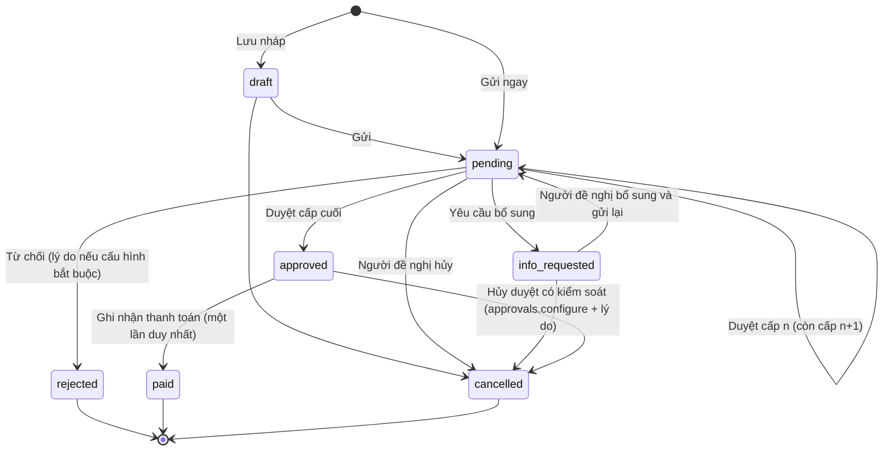

# 7. Quy trình phê duyệt

Module dùng chung: `approval_types` (hạng mục), `approval_rules` (cấp duyệt theo hạn mức), `approval_requests` (yêu cầu), `approval_steps` (lịch sử thao tác), `workflow_definitions/versions` (cấu hình có phiên bản).

## 7.1 Trạng thái yêu cầu

## 7.2 Xác định cấp duyệt

1. Khi gửi, hệ thống lấy các `approval_rules` đang hoạt động của hạng mục mà `min_amount ≤ số tiền ≤ max_amount` (hoặc `max_amount` rỗng).
2. Số cấp cần duyệt = cấp cao nhất thỏa điều kiện (`required_levels`). Ví dụ mặc định: dưới 5 triệu chỉ cần cấp 1 (Kế toán); từ 5 triệu cần thêm cấp 2 (Giám đốc).
3. Người duyệt cấp n: người dùng có vai trò `approver_role_id` hoặc đúng `approver_user_id`, và có quyền `approvals.approve`.
4. **Không tự duyệt**: người đề nghị không được duyệt yêu cầu của mình trừ khi `approval_types.allow_self_approval = true` (chỉ Admin bật được, có nhật ký).
5. Mỗi cấp chỉ có một bản ghi `approve` (unique index) nên không thể duyệt trùng cấp.
6. Hạn xử lý `due_at = requested_at + sla_hours`; quá hạn hiện cảnh báo trên Tổng quan và gửi thông báo.

## 7.3 Sau khi duyệt

- Không sửa trực tiếp số tiền/nội dung (trigger). Muốn thay đổi: tạo yêu cầu "Điều chỉnh doanh thu/chi phí" mới, hoặc Admin hủy duyệt có lý do rồi người đề nghị gửi lại.
- Thanh toán: `record_payment` tạo một dòng `payments` gắn `approval_request_id`; unique index ngăn ghi nhận lần hai; yêu cầu chuyển `paid`.
- Ứng tiền được duyệt → kế toán chi → `advance_transactions(disbursement)`; **không** cộng vào chi phí.
- Chi phí được duyệt → `shipment_expenses.status = approved` → được tính vào chi phí chuyến.

## 7.4 Cấu hình cho quản trị viên

Cho từng hạng mục: ai được gửi (vai trò), người duyệt cấp 1/2/…, điều kiện chuyển cấp (hạn mức), bắt buộc chứng từ, bắt buộc lý do khi từ chối, cho phép tự duyệt, người nhận thông báo, thời hạn xử lý. Mỗi lần lưu tạo `workflow_versions` mới; yêu cầu đang chạy giữ phiên bản lúc gửi (`workflow_version_id`).

## 7.5 Thông báo

| Sự kiện | Người nhận |
|---|---|
| Có yêu cầu mới / chuyển cấp | Người duyệt của cấp hiện tại |
| Được duyệt / bị từ chối / yêu cầu bổ sung | Người đề nghị |
| Đã thanh toán | Người đề nghị (tài xế) |
| Quá hạn xử lý | Người duyệt + Admin |
